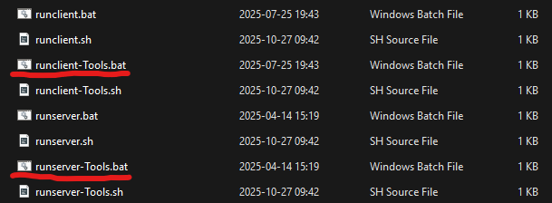

# Mapping Guide

This document serves as a hybrid guide/advisory in making maps for SS14. First of all - nothing here should be taken as gospel, if you can find a good reason to ignore any of these guidelines - do so. We aren't here to stifle your creativity, but to try and ensure that map quality is consistent for all players.


# Getting started

If you want to get into mapping, you will start with [setting up a development environment](https://github.com/space-wizards/docs/blob/master/src/en/general-development/setup/setting-up-a-development-environment.md). The link tutorial for wizards den also works for MoffStation, and almost every other codebase of SS14.

## Tools Build

Once you have your codebase set up and built, start a client and local server in tools mode. A local server is like any other server you see in SS14, except it runs on your computer and only you can access it.

You will want to start your server and client in tools mode. Tools mode will provide access to many of the debug tools needed for mapping, while not including the artificial lag or breakpoints that Debug mode has.

Tools mode can be started in several ways.

- Using the `runclient-Tools.bat` and `runserver-Tools.bat` batch files, found in the root directory of your codebase.

- Using the command line to build and run the server yourself.
```
dotnet run --project Content.Server --configuration Tools
dotnet run --project Content.Client --configuration Tools
```
- Switching the build configuration of your IDE. This will differ depending on what IDE you're using.

## Preparing to map

Once you've started up your server and client, you will be spawned in on Dev Station.

Open up the command console (default tilde), then use the `lsmap` to see all currently loaded maps in the session. Pick any map ID that is not in use, and use the command `mapping [mapID]` to bring up a new empty map to start building in.

If you want to edit an existing map file, use `mapping [mapID] [path]` with an unused mapID and a path to the map you want to edit. Alternatively, use `loadgrid` or `loadmap` to simply load a map without being teleported and given action buttons.

You will also be given action buttons for common tiles and entities - if it didn't come up, try using `mappingclientsidesetup`.

When first loaded, maps will be unititialised. This means all components will be paused and non-functional. Mobs cannot move, including non-admin ghosts. **Do not edit an initialised map**.

## Handy hotkeys
- `B` to open the sandbox menu, with access to handy toggles and menus
- `F5` to open the entity spawn panel
- `F6` to open the tile spawn panel
- `F8` to open the decal spawn panel
- `ctrl+left mouse` to place a rectangle
- `shift+left mouse` to place a line
- `P` to pick a tile or entity
- `middle mouse` to rotate
- `ctrl+middle mouse` to flip

Most hotkeys can be edited in the game options in the controls tab, under "Map Editor".

## Saving your maps

Maps can be saved using `savemap` or `savegrid`. Savemap will save the entire level - and should be used for stations and entire scenes. Savegrid will save a single grid, and should be used for shuttles and ruins.

Maps will be saved to the `/bin/Content.Server/data/` folder. You will need to move it later if you intend to make it into a station.

Your map will also be autosaved at a fixed interval (10 minutes by default) if you have used the mapping command. Autosaves will be stored in `/bin/Content.Server/data/Autosaves/`.

## :rotating_light: DO NOT EDIT AN INITIALISED MAP :rotating_light:

When first loaded, maps will start out unitialised. This means all components will be frozen and fixed in place. Mobs will not move, devices will not operate, and everything is static. This is ideal for mapping - but does prevent you from testing your map out.

Despite the temptation, you must absolutely not attempt to do mapping with an initialised map. Saving initialised maps is unsupported and will likely lead to your map being corrupted if it even saves at all.

If you want to test out your map, save it first, then initialise it. When done testing, load your map into a new MapID (or restart the server) and edit it there.

# Glossary
A lot of synonymous-sounding terms are used in mapping - but they have different meanings depending on context.

## Map/Z Level
SS14 seperates the universe into individual maps (sometimes called Z levels). Maps contain information about them such as the parallax, weather, and the grids inside them. Maps are given a **numeric Map ID** for the session - which is like a parking spot for the map to sit in during the game. When the round restarts, all maps and their contents are deleted, and the new maps are placed at the next available map IDs.

Useful commands:
- `addmap <mapID> [pre-init]` Add a new, empty map to the session.
- `lsmap` List all maps in the current session, with their numeric ID, name and information about them.
- `rmmap <mapID>` Removes a map from the session, deleting it entirely.
- `loadmap <mapID> <path> [x] [y] [rotation] [consistentUids]` Loads a map from the disk into the session, either from `/bin/Content.Server/data/` or `/Resources/` folders. Can only load maps into unused mapIDs, and cannot load maps onto existing maps.
- `savemap <mapID> <path> [force]` Saves a map from the session to the disk. In a developer environment, the resulting files are usually found in `/bin/Content.Server/data/`. **Do not save maps that have been initialized.**
- `tp <x> <y> [mapID]` Teleport to any global coordinate. Can also be used to teleport to other maps with ease.
- `mapinit <mapID>` Initialise the map, starting all of the components as if they had just been loaded into a new game. **Do not save maps that have been initialized. If you are testing your map, save before using this command.**

## Grid
A grid is a singular connected mass of tiles with entities on top of it, which exists inside of a map. Most stations are one singular grid. Shuttles, wreckages, and everything similar are seperate grids. All grids have a **numeric Entity ID** for the session, which is seperate from map IDs.

Shuttles, wreckages and similar objects should be saved as grids. Stations should be saved as maps.

Useful commands:
- `lsgrid` Lists all grids in the current session, with their entity ID, map ID and position. You can also use the admin menu, and navigate to the objects tab to see a list of grids.
- `rmgrid <gridID>` Removes a grid from the session, deleting it entirely.
- `loadgrid <mapID> <path> [x] [y] [rotation] [storeUids]` Load a grid from the disk into the session,, either from `/bin/Content.Server/data/` or `/Resources/` folders. Unlike loadmap, loadgrid can only load grids into existing maps.
- `savegrid <gridID> <path>` Saves a grid from the session to the disk. In a developer environment, the resulting files are usually found in `/bin/Content.Server/data/`. **Do not save grids that have been initialized**.
- `physics com` Toggles a debug display showing the center of mass of entities. Can be used to check if you have accidentally split your grid apart - as every grid will have it's own center of mass shown. Very important when starting off.
- `griddrag` Toggles grid drag, allowing you to drag grids with the mouse. Be careful when using grid drag to not send yourself flying into deep space. Also be certain to toggle it off when done.
- `fixgridatmos <gridID>` Resets the atmosphere of the grid. Grids will always start without air - so make sure to use this command after making changes. Use atmos fix markers to change what gasses are placed in each tile.
- `variantize <gridID>` Shuffles the tile variants of the grid, making tiles look varied. The tile picker will show a preview of all tile variants.

## GameMaps and Stations

Differing from a map, a GameMap is a prototype file that links to a map file, and contains information about all the stations in that map file.

Stations are linked to grids which belong to that station. There is usually only one station, but there can be multiple stations in theory. Every grid that belongs to a station should be given the `BecomesStation` component.

You can find examples of gamemaps in `/Resources/Prototypes/Maps/`

# Designing a station

**TODO: General guidance and ideas**


# Mapping Checklist

**TODO: this part is just copied and edited from upstream, use your intuition first and foremost**

This checklist is a general guide on what items are required for typical SS14 station maps. Small maps and non-standard maps may not be able to fit all the content specified, so use this as general guidelines only.

When necessary, the entity ID will be in brackets if it differs greatly from the name of the item. In most cases, you can just search the name. Names with suffixes such as `[filled]` indicate a variant of an entity.

## Blacklist
The items in the following list should not be placed on maps under any circumstances. Unless you are 100% certain that the item is necessary for your map, do not place it, even if it's in a "hidden" location.

If you do choose to add one of these items, seek permission from a maintainer or the head mapper and specifically mention it in your PR.

- Nuclear Authentication Disk
- Nuclear Authentication Codes
- Items with the `[DEBUG]` suffix
- Items with the `[ADMIN]` suffix
- Items with the `[DO NOT MAP]` suffix
- DAW (Digital Audio Workstation)
- Traitor uplink items
- Tier 2 and Tier 3 research unlocks
- Romerol, in any form

## Item Checklist
Broken down by department and then by individual area, this contains what items should be mapped and what items can optionally be added. Like the rest of this checklist, this is merely guidelines, not written and stone, and does not apply to non-standard maps.

### Command
#### Bridge
Required
- Communications console
- ID card computer
- Station records computer
- Hamlet crate

Optional
- Fireaxe
- Recharger
- Camera, power, atmospheric and crew monitoring consoles
- Security and medical records computers
- Emergency tools and first aid kit
- Fire-safety and emergency locker
- Filing cabinets / drawers
- Red phone
- Blast doors

#### Vault
Required
- Nuke
- Gold Bars (single stack)
- Silver bars (single stack)
- Vault Fridge

Optional
- Golden toolbox, bling, golden cup
- Credits (not excessive, 1k maybe, cargo will want to steal this)
- Premium cigars

#### Captain’s Quarters
Required
- Captain’s locker [Filled]
- Suit storage unit [Captain] (Alternatively, replace the captain's locker with it's Hardsuit variant)
- Glass box [AntiqueLaser, Filled] (Alternatively, replace the captain's locker with it's AntiqueLaser counterpart)
- Captain’s spare ID
- Renault spawner

Optional
- ID card computer
- Communications console
- Red phone
- Bed with captain's bedsheet
- Bathroom with golden toilet
- Fireplace or TV
- Captain's thoughts paper

#### Head of Personnel’s Office
Required
- ID card computer
- Head of personnel's locker [filled]
- Uniform printer
- Cloth and durathread (at least a stack of each)
- Ian spawner
- PTech vending machine

Optional  
- Bed with HoP's bedsheet
- Hand labeller
- Crew monitor
- Personnel crate
- Fax machine
- Spare folders
- Filing cabinet / drawers
- Fireplace or TV
- Desk shutters or deadbolts

#### EVA Storage
Required
- Suit storage units [EVA]

Optional
- Masks
- Tank Dispenser [EVA [O2, N2]]
- Spare tanks
- Oxygen or Nitrogen Canister
- Mag Boots
- Jetpacks
- Spare tools
- Spare materials

### Security
#### General
Required
- Airlock [Brig, Locked], lawyers and heads of staff have access to these doors.
- Jail cells
  - Airlock or windoor [Security, Locked], lawyers and heads of staff cannot access these doors.
  - Brig timers
  - Prison wardrobes [Filled]
  - Evidence lockers
- Security officer's lockers [Filled]
- SecTech vending machines
- Handcuff boxes / ziptie Boxes
- Rechargers

Optional
- Monkin' Donuts vendor
- Criminal records computer
- Camera monitor / telescreen
- SecDrobe
- Interrogation room
  - Interogation lamp
- Break room
- Extra disablers, flashes and stun batons
- Security barriers
- Level 3 biohazard gear closet [Filled, Security]
- EOD closet [Filled]
- Training bomb

Banned
- Syndicate/central command exclusive weapons
- Execution chambers

#### Wardens Office
Required
- Easy vision of jail cells
- Warden’s locker [Filled]
- Suit storage unit [Warden] (Alternatively, replace the warden's locker with it's Hardsuit counterpart)
- Criminal Records Computer
- Station Records Computer

Optional
- Recharger
- Filing cabinets / drawers
- Buttons / remote signallers for controlling doors and blast doors
- First aid kit
- Spare tools
- Camera Monitor / telescreen
- McGriff Spawner
- Direct access to the armory
- Dresser [Filled, Warden]
- Contraband storage crate [Armory, Secure]

#### Head of Security’s Room
Required
- Head of security's locker [Filled]
- Suit storage unit [Head of Security] (Alternatively, replace the head of security's locker with it's Hardsuit counterpart)

Optional
- Bed with HoS's Bedsheets
- Dresser [Filled, Head Of Security]
- Shiva Spawner
- Telescreen / Camera Monitor
- WT550 and spare ammo

#### Armory
Required
- Non-lethal guns
  - Disablers, beanbag shotguns
- Lethal guns
  - Drozd, kammerer, laser, lecter
- Security techfab
- Security hardsuits
- Implanter crate [Secure]

Optional
- Bulletproof armor
- Riot armor
- Reflective vest
- Flashbang box
- Non-lethal and lethal ammo boxes
- Techfab materials
- Extra security barriers
- Extra handcuffs
- Contraband storage crate [Armory, Secure]

#### Perma Brig
Required
- Evidence
- Sustainable food source
  - Hydroponics trays
  - Seeds
  - Seed extractor
  - Mini hoe
  - Water source
  - Bucket or cups
- Sustenance Vendor
- Beds

Optional
- Arcade machines/instruments/toys for boredom
- Microwave and equipment for cooking
- Emergency or prisoner EVA suits locked up
- Hide a tool in a plant pot or toilet

#### Detective’s Room
Required
- Detective’s cabinet [filled]
- Station records computer

Optional
- DetDrobe
- Roleplay items like cigarettes, alchohol, lighters, hats, folders etc
- Filing cabinets / drawers

#### Courtroom
Required
- Defence and prosecution tables
- Judges seat & table
- Witness stand
- Accused stand

Optional
- Audience seats
- Jury stand
- court settlement vault

#### Lawyer's Office
Required
- Desks with seating for lawyer and client

Optional
- Lawdrobe
- Papers and folders
- Other roleplay friendly items

### Medical
#### General
Required
- Reception area
- Medical techfab
- NanoMed
- Medidrobe
- Medicine locker [filled] (Contains general medical items like topicals and syringes)
- Medical doctor's locker [filled] (Contains doctor's equipment such as sterile clothing and health analyzers)
- Medbay exit button

Optional
- Medkits
- Rollerbeds
- Crew monitor
- Medical Records Console
- Breakroom

#### Medbay
Required
- Patient beds
- NanoMed
- Medicine locker [Filled]

Optional
- Medkits
- Individual rooms
- Cryogenics
- Spare medical supplies

#### Chemistry
Required
- Chemical dispenser [Filled]
- ChemMaster 4000
- ChemVend
- Grinder
- Chemical locker
- Hotplate
- Tabletop centrifuge
- Electrolysis unit
- hotplate

Optional
- Extra beaker boxes
- Hand labeller
- Syringe boxes
- Pill boxes
- Drain
- Public front desk
- ChemDrobe
- Condenser

#### Chief Medical Officer’s Room
Required
- Chief medical officer's locker [filled]
- Suit storage unit [Chief Medical Officer] (Alternatively, replace the chief medical officer's locker with it's Hardsuit counterpart)

Optional
- Bed with CMO bedsheet
- Crew monitor console
- Medical records console
- Private examination room
- Cat spawner (Runtime, Exception, Bingus or Floppa are good choices - Runtime will also hunt mice)

#### Morgue
Required
- Morgues
- Airlock [Morgue, Locked] (Allows the chaplain and detective to access the morgue)

Optional
- Crematorium (Preferably put this in the chapel back room)
- Body bag boxes
- Morty
- Surgical equipment for autopsies

#### Paramedic (Optional)
Required
- Crew monitor
- Paramedic's locker

Optional
- Easy access to main hallway
- Rollerbed
- Spare medical supplies

#### Surgery (Optional)
Required
- Operating table
- Body scanner computer
- Surgical tools
- Sterile gloves
- Medical mask
- Nitrous oxide tank [Filled]

Optional
- Public observation room
- Spare blood bags
- Cleaning supplies
- Freezer

#### Virology (Optional)
Required
- Disease diagnoser delta extreme machine
- Vaccinator machine
- Mouth swab box
- Sterile mask box
- Latex gloves box

Optional
- Nitrile gloves (these are better than latex, use sparingly)
- Level 3 biohazard closet
- Isolated ward
- ViroDrobe

### Science
#### General
Required
- R&D computer
- Autolathe
- Protolathe
- Circuit Imprinter
- Scientist Locker
- Limited starting materials (Steel, Glass, Plastic only)

Optional
- Grinder
- Smile Spawner
- Beaker boxes
- Syringe boxes
- Fire Safety Closets
- Cell Chargers
- Empty Gas Canisters
- Signs for specific areas
- Filing Cabinets
- Scidrobe
- Vendomat

#### Anomaly lab
Required
- Anomaly generator
- 1-3 Anomaly vessels
- 1-3 APEs
- Anomaly scanner

Optional
- Protective equipment
- R&D computer
- Spare tools/equipment
- Hand labeller
- Plasma (single stack)
- Unfinished machine frames for more anomaly vessels/APEs

#### Artifact lab
Required
- Containment chamber for artifacts
- Artifact analyser
- Analysis console
- Artifact spawner
- Artifact containers

Optional
- Pumps for adding/removing gasses
- Blast doors to space the chamber
- Airlocked doors leading into containment chamber
- Gas canisters with common gasses such as oxygen, nitrogen and carbon dioxide
- Empty gas canisters
- Biohazard, radiation and EOD protection lockers
- Folders and filing cabinets for storing printouts

#### Robotics
Required
- Exosuit fabricator
- Cyborg recharging stations
- Operating table & body scanner computer
- Morgue
- Robotech deluxe

Optional
- Public front desk
- Charging bay with shutters
- Spare tools
- Spare materials

#### Server Room
Required
- R&D server

Optional
- Crew monitoring server
- R&D computer
- Freezer setup

#### Research Director’s Room
Required
- Research director's locker [Filled]
- Suit storage unit [Research Director] (Alternatively, replace the Research director's locker with it's Hardsuit counterpart)
- R&D computer
- Robotics control console

Optional
- Bed with RD bedsheet
- Bandito Spawner
- Power Drill
- RD’s potted plant
- Lamarr poster

### Supply
#### Cargo Reception
Required
- Cargo Request Computer (either public or behind a counter)
- Counter for orders and or conveyor with flaps
- Cargo Bounty Computer

Optional
- Waiting area for placing orders
- Cargodrobe
- Autolathe

#### Cargo Bay
Required
- Space for crates to sit for import / export
- Cargo Shuttle Console
- Cargo Shuttle Computer

Optional
- Starting materials (Glass, Steel, Plastic only, 1 stack max)
- First Aid Kit / Oxy Deprevation Kit
- Toolbox
- Filing Cabinet
- Material Reclaimer
- Filled Crate Spawner [Low Value]
- Empty Crate Spawner

#### Quartermaster’s Room
Required
- Quartermaster’s Locker [filled]

Optional
- bed/qm bedsheet
- Decoration
- Morticia Spawner

#### Salvage
Required
- Salvage Specialist’s Locker
- Salvage Magnet
- Airlock to space
- Salvage Vending Machine
- Ore Processor
- Salvage Expeditions Computer
- Salvage Shuttle Console

Optional
- Tank Dispenser [EVA]
- Extra Tools (shovels/pickaxes)
- Fire Extinguishers
- First Aid Kit

## Engineering
##### Main Engineering

Required
- Engineer Lockers
- Youtool
- Engivend
- Protolathe
- Autolathe
- Steel, Plasteel, Glass, Metal rods (limited)
- Pacman and Super Pacman
- Plasma Gas Tank Dispenser

Optional
- Bulk Cable Crate
- Handheld Radios
- Flashlights
- Fuel Tanks
- Solar Control Computer
- Power Monitoring Computer (HV cable under it)
- Tool Boxes
- Cell Rechargers
- Engidrobe
- Welding Supplies Locker
- Electrical Supplies Locker

#### Chief Engineer’s Room
Required
- Chief Engineer’s Locker [filled]
- RCD

Optional
- bed/ce bedsheet
- RCD Ammo
- Cell Rechargers

#### AME
Required
- Room to build the ame (5x5 minumum)
- Antimatter Control Unit
- Packaged Antimatter Reactor Parts
- Antimatter Containment Jars (1-2)
- HV cable under control unit
- HV to SMES cable terminal input

#### Solars
Required
- Solar Panels
- HV cable (can be pre installed but recommended to only partially install so engineers have something to do)
- HV to SMES cable terminal input
- Solar Tracker

#### Singularity Engine
Required
- 4 containment field generators
- 1 gravitational singularity generator
- 4-8 radiation collectors in line of sight of singularity (depends on stations power needs)
- enough emitters for each containment field generator
- particle accelerator (preferably partially or completely unassembled)
- HV to SMES cable terminal input

#### SMES power banks
Required
- Power gen going into SMES cable terminals as input
- Outgoing power to station from under SMES to station substations

#### Telecomms
Required
- Telecommunications Servers

##### Atmospherics
Required
- Atmospheric Technician’s Locker [filled]
- Working waste loop
- Working distro loop
- Working n2/o2/recycling

Optional
- filter traps for various gasses
- mixer/combustion tank
- various gas canisters
- freezers/coolers availble for heating/cooling pipenets as needed
- atmos drobe
- atmos plaque
- atmosia declaration of independence
- fire safety closets
- fireaxe cabinet
- TEG Setup (look at other maps for examples)

## Service

#### Kitchen
Required
- Microwave(s)
- Grinder
- Meatspike
- Sinks
- Chef’s closet
- Dinnerware machine
- Freezers
  - Drain
  - Freezer Atmos Markers
  - Tiny fans under doors

Optional
- Extra microwaves and grinders for multiple chefs
- Chefdrobe
- Spare universal enzymes
- Cow crate/monkey cubes
- Cold/Hot food carts

#### Botany
Required
- Megaseed Servitor
- Seed Extractor
- Hydroponics Tray
- Botanist’s Locker [filled]
- High Capacity Water Tank
- Buckets

Optional
- Hydrobe
- Nutrimax Machine
- Grinder
- Extra Botany Tools
- Windows to kitchen or chem or both

##### Bar
Required
- Booze Dispenser
- Soda Dispenser
- Booze-o-mat
- Booze Storage
- Sink
- Social area for crew

Optional
- Bardrobe
- Pun Spawners
- Extra Shakers
- Box of Beanbag shells
- Monkey Painting

#### Janitor’s Closet
Required
- Janitorial Supplies Crate
- Soap
- Box of Trashbags
- Space Cleaner Bottle
- Mop & Bucket
- Drain
- Janidrobe
- Janitor Trolley
- Janicart spawner + keys

Optional
- Janitor biohazard closet
- Restock Box Spawner
- Janitorial Trash Cart
- Extra light boxes and light replacers
- Custodial closets
- Wet floor signs

## Misc
#### Arrivals
Required
- A safe area for late spawns
- 3xternal airlocks to space (complete with locked docking airlocks)

Optional
- Non functional docked arrivals shuttle
- Vending Machines / Arcade Machines
- Emergency closets
- Emergency toolboxes/crowbars

#### Chapel
Required
- Roleplay friendly area for chaplain
- Pietyvend
- Altar Spawner

Optional
- Chaplain’s wardrobe
- bed/cult bedsheet
- Crematorium
- Church Organ
- Confession Booth

#### Library
Required
- Roleplay friendly area for librarian
- Fun & Games Machines
- Books Bag

Optional
- Lots of bookcases
- Fax Machine
- Paperwork Spawner
- Figuring Spawner
- Games table
- Board games
- Fun toy spawns or instrument spawns
- Paper for librarian to write books
- Lantern

#### Maints
Required
- Emergency and Fire Closets near doors
- Water and Fuel Tanks spread out
- Hidey Holes
- Maintenance Closet [filled]

Optional
- Decorations
- Fun hidden stuff
- Maint loot spawners
- Crate Spawners (random and empty)
- Mouse spawners (one or two timed)
- Hidden areas
- Cosmetic loot
- Tools
- Garbage and Trash Spawners

#### Disposals
Required
- A working disposals system (conveyors and toggled blast doors or recycler)
- Recycler
- Airlock to eject trash to space or disposals into space
- Material Reclaimer

#### Theater Room
Required
- Spawns for clown, mime, and musician
- Autodrobe

Optional
- A stage for them to act on
- Bananas and pies for clown, crayons for mime, instruments for musician etc
- Mime & Clown bedsheets

#### Tool Room
Required
- Youtool machine
- Vendomat

Optional
- Extra tools & tool boxes
- Pair of budget insulated gloves
- Vending machines

#### General
Optional
- Disposals machines spread out in convenient locations
- Vending machines, table & chairs and plants to fill up long stretches of hall
- Use indents, curves and bends as well as features in the center of corridors to break them up
- Use directional signs to departments at intersections or heavy foot traffic areas
- Break up halls with glass airlocks and plenty of fire locks
- You can also use common rooms and parks to break a hallway